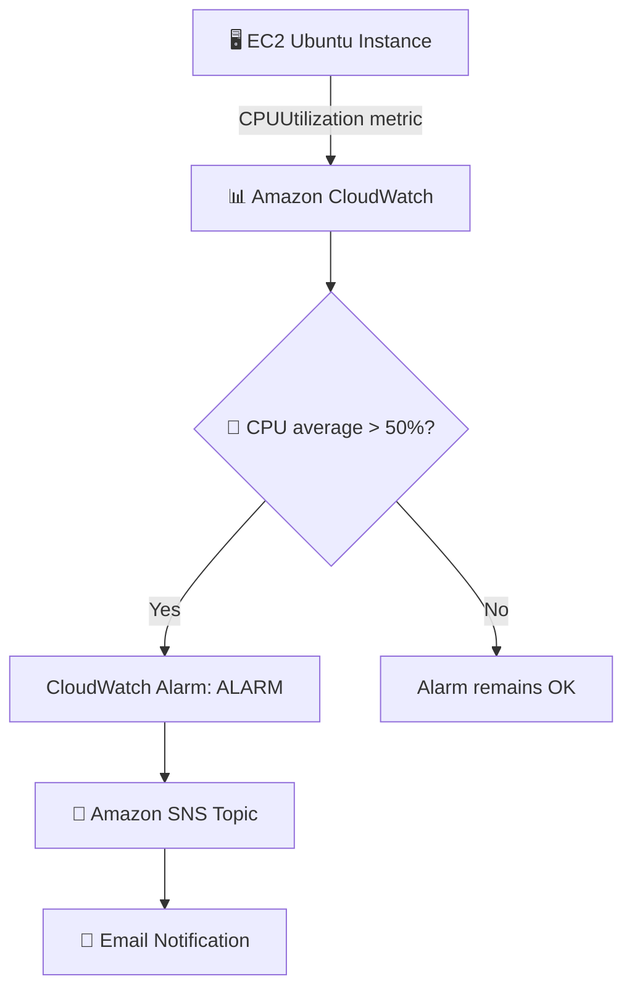
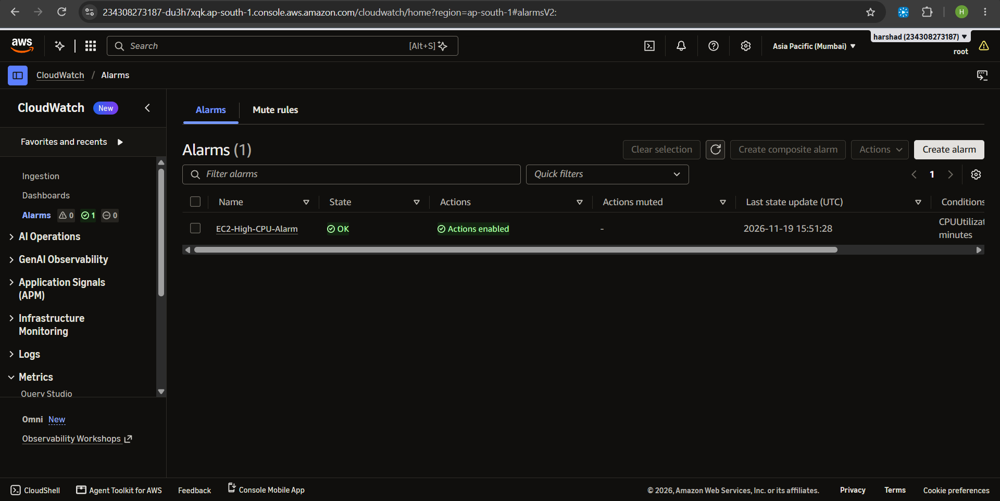
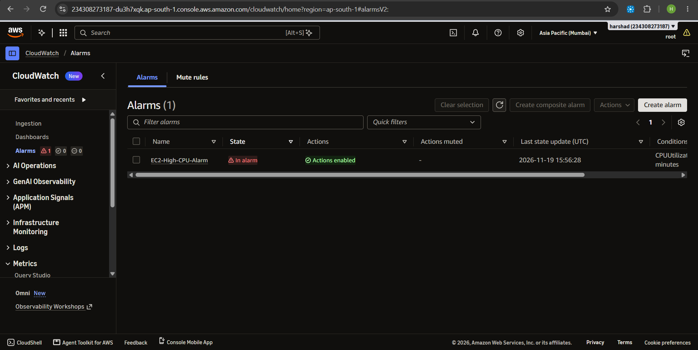

# ☁️ AWS EC2 CPU Monitoring & Email Alerting

> A hands-on AWS monitoring project that tracks EC2 CPU utilization with Amazon CloudWatch and sends automated email notifications through Amazon SNS when CPU usage exceeds a configured threshold.

<p align="center">
  
</p>

---

## 📌 Project Overview

Monitoring is an important part of cloud operations and DevOps.

In this project, I configured a CloudWatch alarm to monitor an EC2 instance's CPU utilization and notify me by email when CPU usage goes above **50%**.

To validate the setup, I generated CPU load on the EC2 instance using a Python script, observed the metric spike, confirmed that the alarm changed from **OK** to **ALARM**, and verified that an SNS email notification was received.

---

## 🎯 Objectives

- 📈 Monitor EC2 CPU utilization with Amazon CloudWatch.
- 🚨 Create an alarm for CPU utilization above 50%.
- 📬 Deliver alarm notifications using Amazon SNS email subscription.
- 🧪 Simulate CPU load and verify the complete alerting workflow.

---

## 🏗️ Architecture



### 🔄 Workflow

1. 🖥️ The EC2 instance publishes CPU utilization metrics to CloudWatch.
2. 📊 CloudWatch evaluates the metric using the alarm's configured period and statistic.
3. 🚨 If average CPU utilization is greater than **50%**, the alarm enters the `ALARM` state.
4. 📣 The alarm publishes a notification to the configured SNS topic.
5. 📧 SNS sends an email to the confirmed subscription address.
6. 🧪 A CPU stress test is used to validate the end-to-end flow.

---

## 🧰 AWS Services & Tools

| Service / Tool | Purpose |
|---|---|
| 🖥️ Amazon EC2 (Ubuntu) | Instance being monitored |
| 📊 Amazon CloudWatch | Metrics, graph, and alarm evaluation |
| 🚨 CloudWatch Alarm | Detects CPU utilization above the threshold |
| 📣 Amazon SNS | Sends alarm notifications to subscribers |
| 🐍 Python 3 | CPU load-generation script for testing |
| 🐧 Linux | Run the test script on the EC2 instance |
| 🌏 AWS Region | `ap-south-1` (Mumbai) |

---

## ⚙️ Alarm Configuration

| Setting | Value |
|---|---|
| Alarm name | `EC2-High-CPU-Alarm` |
| Metric namespace | `AWS/EC2` |
| Metric name | `CPUUtilization` |
| Dimension | Monitored EC2 `InstanceId` |
| Statistic | Average |
| Period | 300 seconds (5 minutes) |
| Threshold | Greater than 50% |
| Evaluation | 1 out of 1 datapoints |
| Missing data | Treated as missing |
| Alarm action | Publish notification to SNS topic |

---

## 🚀 Implementation Steps

### 1️⃣ Launch the EC2 Instance

- Launch an Ubuntu EC2 instance in the Mumbai region (`ap-south-1`).
- Connect to the instance using SSH.
- Confirm that the instance is running and reporting metrics.

### 2️⃣ Create an SNS Topic and Email Subscription

- Create an SNS topic for CloudWatch alarm notifications.
- Add an email subscription.
- Confirm the subscription using the confirmation email from AWS.

> ⚠️ Email notifications will not be delivered until the SNS subscription is confirmed.

### 3️⃣ Create the CloudWatch Alarm

- Select the EC2 `CPUUtilization` metric for the instance.
- Configure the statistic as **Average** and period as **5 minutes**.
- Set the threshold to **Greater than 50%**.
- Configure **1 out of 1 datapoints** for the alarm transition.
- Select the SNS topic as the alarm notification action.

### 4️⃣ Generate CPU Load

Use the included Python script to simulate CPU load on the instance.

```bash
python3 scripts/stress.py 2 600
```

**Arguments:**

- `2` — Number of CPU worker processes
- `600` — Duration in seconds (10 minutes)

⚠️ Use the script only on an instance you own or are authorized to test. CPU load can affect performance and may incur AWS charges.

### 5️⃣ Observe and Validate

- 📈 Watch the CPU utilization metric in CloudWatch.
- 🚨 Confirm the alarm transitions from `OK` to `ALARM` after the threshold is breached.
- 📧 Confirm the SNS email arrives.
- 🟢 After the load ends, observe CPU returning toward baseline and the alarm recovering when its conditions are met.

---

## 🧪 Test Results & Screenshots

The monitoring workflow was tested by generating CPU load on the EC2 instance. CloudWatch detected CPU utilization above the configured threshold, the alarm entered `ALARM`, and the SNS email notification was received.

### 🟢 Alarm in OK State



### 🐍 CPU Stress Test Running on EC2


### 📈 CPU Utilization Spike


### 🚨 CloudWatch Alarm in ALARM State



### 📧 SNS Email Alert Received


---

## 🧯 Troubleshooting Notes

| Issue | Possible Solution |
|---|---|
| 📭 Email not received | Confirm the SNS email subscription is in `Confirmed` status and check spam/junk folders. |
| 🟢 Alarm remains OK | With 5-minute metrics, allow time for metric publication and alarm evaluation. Verify that CPU actually exceeds the threshold. |
| ⚠️ Insufficient data | Confirm the EC2 instance is running and has begun publishing metrics. |
| 📉 Metric is not visible | Check the AWS region and select the correct instance ID in CloudWatch metrics. |

---

## 📚 Key Learnings

- 📊 CloudWatch metrics, namespaces, dimensions, statistics, and periods.
- 🚨 Alarm states: `OK`, `ALARM`, and `INSUFFICIENT_DATA`.
- 🔔 Connecting CloudWatch alarms to SNS for automated notification delivery.
- 📬 SNS email subscription confirmation.
- 🧪 Validating monitoring through a controlled CPU load test.
- ⏱️ How metric periods affect alerting latency.
- 🔐 Basic AWS security practices, including avoiding root-user access for routine work and enabling MFA.

---

## 🔮 Future Improvements

- 🏗️ Provision the infrastructure with Terraform.
- ⏱️ Enable detailed monitoring for 1-minute metrics (additional charges may apply).
- 🧠 Monitor memory and disk metrics using the CloudWatch Agent.
- 📊 Create a CloudWatch dashboard for CPU, network, memory, and disk metrics.
- 💬 Add Slack or Microsoft Teams notifications using an integration (for example, SNS with Lambda).
- ⚖️ Explore automated scaling or remediation actions triggered by alarms.

---

## 💰 Cleanup / Avoid Unnecessary Charges

When finished testing, review and remove resources you no longer need:

- 🖥️ Terminate the EC2 instance if it is no longer required.
- 🚨 Delete the CloudWatch alarm.
- 📣 Delete the SNS topic and subscription if no longer needed.
- 💾 Review associated storage (such as EBS volumes and snapshots) and other billable resources.

---

## 📁 Repository Structure

```text
aws-cloudwatch-cpu-alarm/
├── README.md
├── .gitignore
├── push.sh
├── scripts/
│   └── stress.py
└── screenshots/
    └── images/
        ├── cloudwatch-alarm-ok.png
        ├── ec2-stress.png
        ├── cloudwatch-cpu-spike.png
        ├── cloudwatch-alarm-in-alarm.png
        └── sns-email-alert.png
```

---

## 🏷️ GitHub Topics

`aws` · `amazon-ec2` · `amazon-cloudwatch` · `amazon-sns` · `monitoring` · `alerting` · `devops` · `cloud-computing` · `python` · `linux`

---

## 👨‍💻 Author

**Harshad Gaikwad**  
Aspiring Cloud / DevOps Engineer

---

⭐ If you find this project useful, feel free to star the repository!