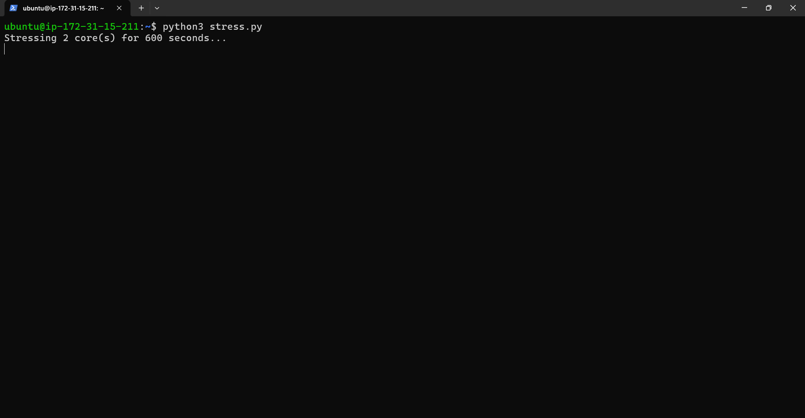
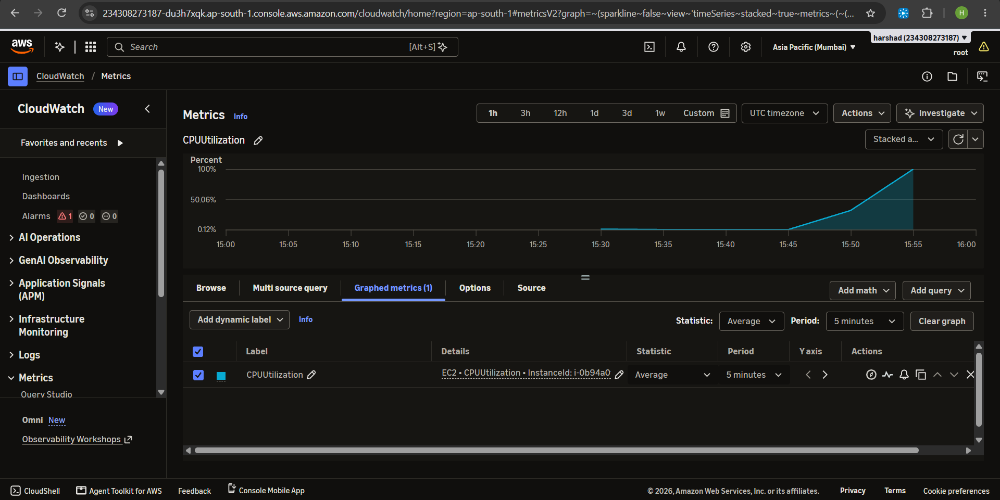
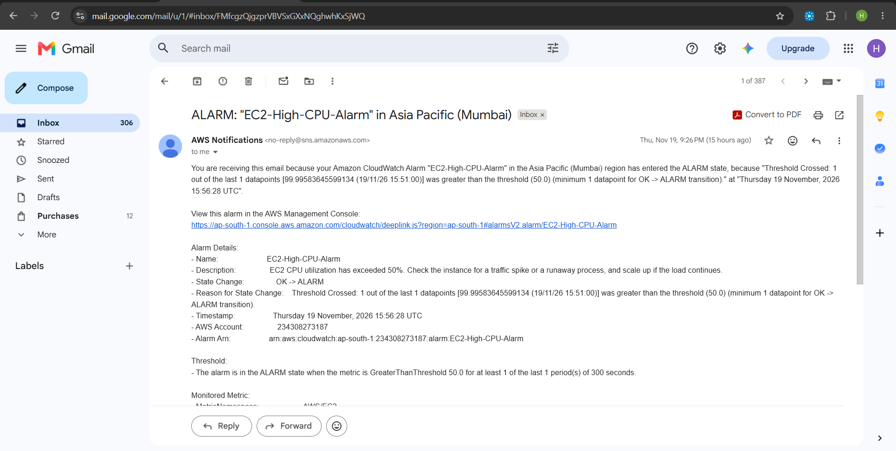

# ☁️ AWS CloudWatch: EC2 High CPU Alarm with Email Alerts

A hands-on monitoring and alerting project on AWS. A CloudWatch alarm watches the CPU of an EC2 instance and sends an email through Amazon SNS when CPU utilization goes above 50%. I tested the full flow by generating real load with a Python stress script.


## Project overview

Monitoring is a core part of DevOps and SRE work. The goal of this project is to set up automatic alerting so that a team is notified as soon as a server is under heavy load, instead of finding out from users.

- An EC2 instance sends its CPU metric to CloudWatch, which watches it with an alarm set at 50%.
- When the threshold is crossed, the alarm triggers Amazon SNS, which sends an email alert.
- I tested the full flow by generating real load with a Python stress script.

## 🏗️ Architecture

```
EC2 instance (Ubuntu, "server")
        |
        |  publishes CPUUtilization metric every 5 minutes
        v
Amazon CloudWatch (metric: AWS/EC2 CPUUtilization)
        |
        |  alarm evaluates: Average > 50% ?
        v
CloudWatch Alarm: EC2-High-CPU-Alarm
        |
        |  state changes OK -> ALARM
        v
Amazon SNS topic
        |
        v
Email notification
```

## How the project works

1. **EC2 sends metrics.** The Ubuntu EC2 instance automatically reports its `CPUUtilization` metric to CloudWatch in the `AWS/EC2` namespace. With basic monitoring this happens every 5 minutes, with no agent to install.
2. **CloudWatch evaluates the alarm.** The alarm `EC2-High-CPU-Alarm` checks the Average CPU over each 300-second period. If the value is greater than 50, the alarm changes from **OK** to **ALARM**.
3. **SNS delivers the notification.** The alarm's ALARM action publishes a message to an SNS topic. The topic has an email subscription, so the message arrives in my inbox.
4. **Load test proves it end to end.** I ran `stress.py` on the instance to push CPU to about 100%. The graph spiked, the alarm fired, and the email arrived.

## Tech stack

| Service / tool | Purpose |
|---|---|
| Amazon EC2 (Ubuntu) | The server being monitored |
| Amazon CloudWatch | Metrics, graphs, and the alarm |
| Amazon SNS | Sends the email notification |
| Python 3 | CPU stress script to simulate load |
| Region | `ap-south-1` (Mumbai) |

## Alarm configuration

| Setting | Value |
|---|---|
| Alarm name | `EC2-High-CPU-Alarm` |
| Namespace / Metric | `AWS/EC2` / `CPUUtilization` |
| Dimension | `InstanceId` of the monitored instance |
| Statistic | Average |
| Period | 300 seconds (5 minutes) |
| Condition | Greater than 50, 1 out of 1 datapoints |
| Missing data | Treated as missing |
| ALARM action | Publish to SNS topic (email subscription) |

## Step-by-step setup

1. **Launch an EC2 instance.** Create an Ubuntu instance named `server` in `ap-south-1` and connect to it over SSH.
2. **Create an SNS topic.** Add an email subscription, then confirm it from the confirmation email AWS sends. Alerts will not arrive until the subscription is confirmed.
3. **Create the CloudWatch alarm.** Select the `CPUUtilization` metric for the instance, set the statistic to Average, the period to 5 minutes, and the threshold to greater than 50. Set the ALARM action to the SNS topic.
4. **Check the baseline.** CPU should be near idle and the alarm should show **OK**.
5. **Run the stress script** on the instance:
   ```bash
   python3 scripts/stress.py 2 600
   ```
6. **Watch the metric.** In CloudWatch, CPU climbs to about 100%.
7. **Confirm the alert.** The alarm moves to **In alarm** and the email arrives.

## Testing and results

The alarm went from OK to ALARM at **15:56:28 UTC** (19 Nov 2026), after the average CPU reached about 99.99%, and the email notification arrived right after.

### 1. Alarm in OK state (before the test)


### 2. Running the stress script on EC2



### 3. CPU spiking to about 100%



### 4. Alarm in ALARM state


### 5. SNS email alert received



## Troubleshooting notes

- **No email received:** the SNS subscription must be confirmed first. Check the Subscriptions page for the status "Confirmed".
- **Alarm stays in OK:** basic monitoring reports every 5 minutes, so the alarm can take up to one or two periods to react after the load starts.
- **Alarm shows "Insufficient data":** the instance may be stopped or not reporting metrics yet.

## What I learned

- How CloudWatch metrics, namespaces, dimensions, periods, and statistics work together to drive alarm evaluation.
- The three alarm states (OK, ALARM, Insufficient data) and how a metric crossing a threshold triggers a state change.
- How to connect CloudWatch alarms to SNS so alerts reach people automatically.
- Why SNS subscriptions need to be confirmed before they deliver messages.
- How to validate monitoring by simulating real load, instead of just trusting the configuration.
- How basic monitoring (5-minute data) differs from detailed monitoring (1-minute data) and why alert delay depends on the period.
- Security habits: hide account IDs in screenshots, and use an IAM user with MFA instead of the root account for daily work.
- How to document a project clearly with a README, screenshots, and a repeatable setup.

## Future improvements

- Build the whole setup with **Terraform** so it is repeatable and version controlled.
- Enable **detailed monitoring** for 1-minute metrics and faster alerts.
- Add alarms for memory and disk using the **CloudWatch Agent**.
- Add a **CloudWatch dashboard** for CPU, network, and disk in one view.
- Send alerts to Slack or Microsoft Teams through SNS and Lambda.
- Trigger an **Auto Scaling** action when the alarm fires.

## Cleanup

To avoid charges, delete resources you no longer need:

- Terminate the EC2 instance
- Delete the CloudWatch alarm
- Delete the SNS topic and subscription

## Repository structure

```
aws-cloudwatch-cpu-alarm/
├── README.md
├── .gitignore
├── scripts/
│   └── stress.py
└── screenshots/
    └── images/
        ├── cloudwatch-alarm-ok.png
        ├── ec2-stress.png
        ├── cloudwatch-cpu-spike.png
        ├── cloudwatch-alarm-in-alarm.png
        └── sns-email-alert.png
```

## Author

**Harshad**, aspiring DevOps / Cloud engineer. [GitHub](https://github.com/harshad-09)
